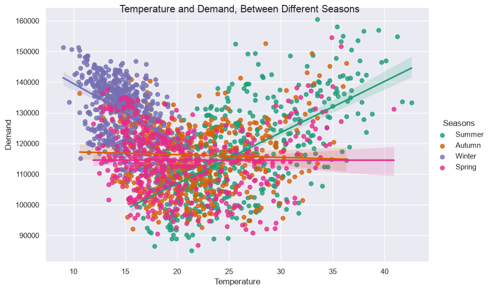
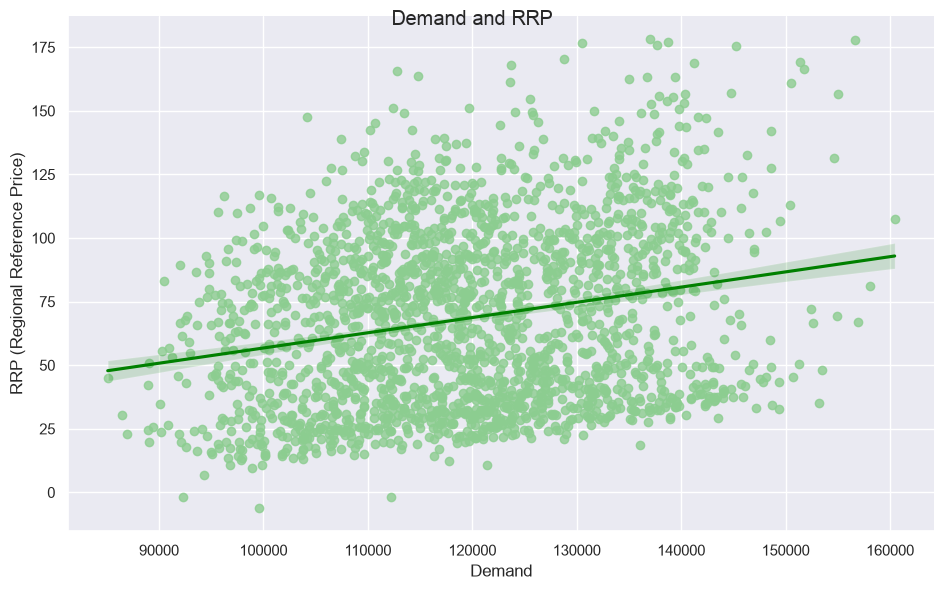
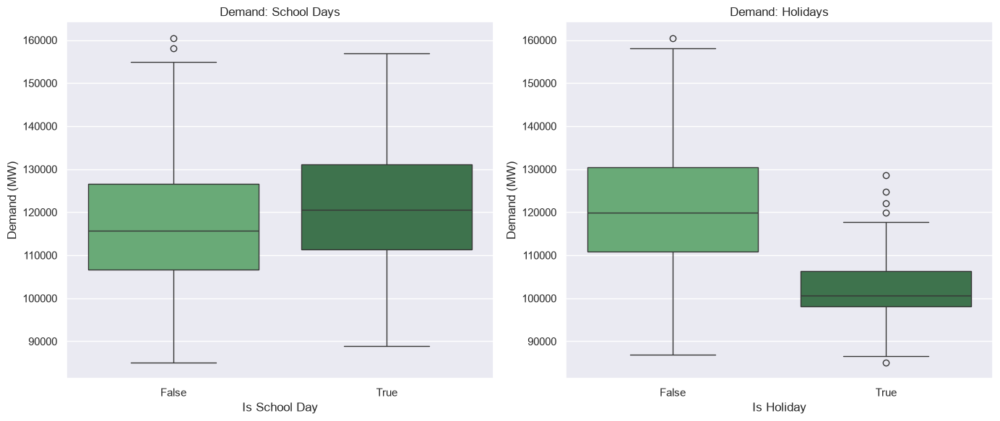

# Electricity Demand and Pricing

## 1. Project Overview

This project explores electricity demand and pricing in Victoria, Australia using the [Daily Electricity Price and Demand Data](https://www.kaggle.com/datasets/aramacus/electricity-demand-in-victoria-australia) dataset.

The analysis aims to investigate how electricity demand and prices vary over time and how they relate to external factors such as temperature, seasonality, weekends, and public holidays. It also explores patterns in electricity pricing, including periods of unusually high demand and negative prices.

## 2. Problem Statement

Understanding the relationship between electricity demand, weather, calendar patterns, and wholesale prices is important for identifying trends and unusual market behavior.

## 3. Objectives

- Identify seasonal patterns in electricity demand and determine how temperature influences consumption.
- Investigate the frequency and conditions under which negative electricity prices occur, exploring potential contributing factors.
- Analyze the relationship between electricity demand and wholesale electricity prices.
- Compare electricity demand and prices between working days, weekends, and public holidays.

## 4. Research Questions

- How does electricity demand change with temperature and season?
- Are high-demand days associated with higher prices?
- How do weeekends and holidays differ from working days?
- How often do negative prices occur, and under what conditions?

## 5. Hypotheses

- Electricity demand increases during periods of extreme temperatures, both hot and cold.
- Electricity demand is generally lower during weekends than working days.
- High demand days are NOT associated with higher prices.

## 6. Findings:

### How does electricity demand change with temperature and season?

#### Approach

- Investigated the relationship between temperature and demand.
- Compared average demand across seasons.
- Examined the temperature and demand relationship, between different seasons.

#### Key findings:

- During lower temperatures there is more electricity demand on average. But, the highest demand occurs during higher temperatures.
- On average, the winter season (June, July and August) has the highest demand.
- Summer is the season with the most variability, whereas winter has the lowest variability.

Findings align with original hypotheses.

### Are high-demand days associated with higher prices?

#### Approach

- Plotted demand against RRP (regional reference price)
- Printed correlation between the two variables

#### Key findings:

- Higher demand tends to coincide with higher prices, but the relationship is not strong.
- The result of the Pearson correlation is 0.23

### How do weekends and holidays differ from working days?

#### Approach

- The dataset doesn't provide a workday/weekend column. Instead I used the school days column for working days, and non school days for weekend.
- Plotted school days and holidays against demand

#### Key findings:

- Demand is higher on school days, compared to weekends.
- Demand is much higher on non-holidays, compared to holidays.

The findings are aligned with original hypotheses.

